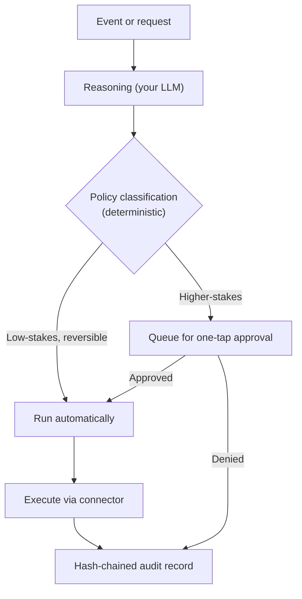
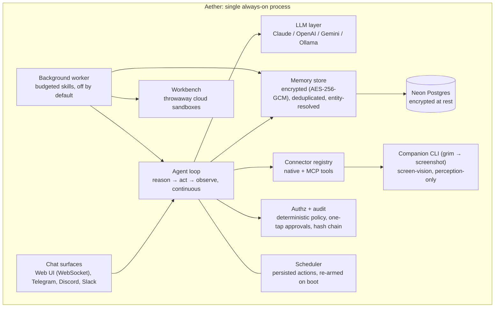

# Aether

**A personal agent you can give write access to, because it shows its work.**

[](LICENSE)
[](#quick-start)
[](pyproject.toml)
[](#roadmap)

*An approval request arrives in chat, one tap approves it, and the audit
record appears.*

Aether watches your email, calendar and messaging apps, remembers what is
happening across all of them, and takes real action: replying, booking,
filing, following up. Every action is checked against a policy you wrote
before it runs, and every decision is written to a tamper-evident log you
can read afterwards.

It can also work while you are away — following up, researching,
describing files — inside budgets you set, bringing back results that
wait for your verdict. That mode is off by default;
["A night with Aether"](#a-night-with-aether) shows what it looks like
switched on.

---

## A day with Aether

You told a recruiter on Monday you'd send your availability by Thursday.
Thursday comes and goes. You are busy, not careless.

**Without Aether:** the thread goes quiet. The recruiter moves on.

**With Aether:**

1. It notices the open promise in your email, and sees the same recruiter
   pinged you on Telegram under a different handle. Both threads resolve
   to one person.
2. It drafts a follow-up with your free slots.
3. Your policy says *drafts to existing contacts are low-stakes*, so the
   draft is created automatically.
4. Your policy also says *sending to someone outside the last 30 days
   needs approval*, so the send waits as a one-tap approval in your chat.
5. You tap approve. The message goes out.
6. The audit log now holds a record of the event, the rule that matched,
   the decision, and who approved it. Each record is hash-chained to the
   one before it, so editing history afterwards is detectable.

You never had to trust the agent blindly. You had to trust a policy you
can read and a log you can verify.

## A night with Aether

You tell Aether who you are once — a line about your work, your
schedule, how you like your replies. That is the seed of a profile, and
the only thing it takes on faith. Everything it notices about you later
lands as a pending entry that waits for your yes.

With the background worker switched on, every half hour or so:

1. It looks around your memory for things you left open — a promise you
   made, a thread you meant to answer, a file you shared and never
   described.
2. It drafts the follow-up, runs a web search on what you were reading
   about, or sends the file through a describing job — at most a few
   tasks a day, inside the budgets in `config.yaml`.
3. Results arrive as short messages — five a day at most, held during
   your quiet hours — each with one-tap buttons: **Approve**, **Revise**
   or **Discard**. The same buttons sit on the panel's Tasks page, and
   Revise simply means: send the corrected version in chat and it takes
   it from there.
4. Approve carries the action out, but only after re-checking that the
   thread is still open and the slot is still free. If the world moved
   on, it says so plainly and drops the draft instead of sending.
5. Discard teaches it: the same opportunity never comes back, and the
   skill that produced it carries less weight for the next month.

If too much comes back wrong — three discards in a row, or one skill
refused three times — the worker pauses itself and says so in one
message. You can also say `/pause` or `/resume` in chat at any moment.

Heavy work does not run on your machine. A job runs in a throwaway cloud
sandbox — Modal by default, Vercel as a fallback, or a GitHub Actions
batch queue for patient, non-sensitive jobs
([`docs/github-actions-sandbox.md`](docs/github-actions-sandbox.md)) —
which receives only the files the task needs and never Aether's keys.

## Why this exists

A person can keep track of their email, chats and calendar. No one can do
it continuously, across every app, all day, without fail. That is a limit
of attention, not discipline.

Agents that act on your behalf can remove that burden, but only if you can
let them act. Most people won't hand write access to something they can't
inspect. Aether is built so that access is bounded before the action,
explainable during it, and verifiable after it.

## How a single action flows



1. **Event or request.** Something arrives from a connected app, a schedule
   fires, or you ask in chat.
2. **Reasoning.** The agent loop (reason, act, observe) decides what to do
   using your configured model and its memory of what is going on.
3. **Policy classification.** The proposed action is classified against
   your declared policy *before* it executes. This step is deterministic
   code, not the model's judgement.
4. **Auto-run or approval.** Low-stakes, reversible actions proceed.
   Higher-stakes ones queue for a one-tap decision in your chat surface.
5. **Execution.** The action runs through a connector.
6. **Audit record.** The decision is appended to a hash-chained log.

## Features

### Trust & control

- **Deterministic authorization.** Every action is classified against a
  declared policy before it runs. The model proposes; the policy decides.
- **One-tap approvals.** Higher-stakes actions wait for you, in the chat
  surface you already use.
- **Tamper-evident audit.** Every decision produces a hash-chained record.
  Secrets are never written to it: it names keys only.
- **Your contacts, your rules.** An explicit allowlist decides which
  contacts the agent may see on every channel — one list and one switch
  per connected app, plus a list that counts everywhere. Non-allowlisted
  senders are dropped at ingestion, and bulk reads (like the inbox) are
  filtered the same way before the agent ever sees them; their content is
  never stored.

### Memory & understanding

- **Continuous cross-app monitoring.** Aether keeps a running,
  deduplicated memory rather than a raw activity log.
- **Cross-platform identity resolution.** The same person under different
  handles on different platforms is linked into one coherent memory of that
  relationship.
- **Signal over noise.** A continuous event stream is filtered down to a
  small set of genuinely relevant items, with no human labelling what
  matters.

### Reach

- **Any app that speaks MCP.** Mail, calendar, and anything else with an
  [MCP](https://modelcontextprotocol.io) server connects through Aether's
  MCP host, configured in `config.yaml`.
- **Native chat connectors.** Telegram, Discord and Slack are built in,
  because they double as chat and approval surfaces. WhatsApp is a
  documented stub; both free routes (Meta test number, WAHA QR bridge) are
  in [`docs/whatsapp.md`](docs/whatsapp.md).
- **Screen-vision fallback.** For apps with no API, a companion CLI
  captures your screen on request, and Aether reads and remembers what is
  on it. It is strictly perception-only: it never acts inside an app it
  cannot reliably interact with.

### Works while you sleep

- **A profile you confirm.** What you tell Aether about yourself is the
  seed; what it gathers on its own waits as pending entries until you
  say yes — in chat, or on the panel's Settings page.
- **Skills, not free rein.** Follow-ups on promises it finds in memory,
  background research over the web, and descriptions of files you
  share. Each tool call a skill makes still passes the same policy
  gate, and detection and planning are hard-limited to read-only tools
  in code, not in a prompt.
- **Web research, capped and untrusted.** A hardened page fetcher and a
  free-tier search tool, both capped per day. Fetched pages and search
  results are data: they can never write your profile directly — the
  only path from web content to the profile is a proposal that lands as
  pending, waiting for your confirmation.
- **Budgets and a kill switch.** Tasks, tokens, sandbox minutes and
  notifications per day, all in config, all checked before the work
  happens. The worker is off by default, and pauses itself — a pause
  that survives restarts — if its work keeps coming back wrong.
- **Verdicts that teach.** Approve, revise or discard from any surface:
  chat, Telegram, Discord, Slack or the panel. Feedback shapes which
  skills run next month, and the same opportunity never fires twice.

### Flexibility

- **Bring your own model.** Claude (Anthropic API), OpenAI, Google Gemini,
  or a local Ollama model. Switching is one line of config.

## Policy example

Authorization rules live in `config.yaml`. The snippet below is
illustrative of the idea; check `config.example.yaml` for the exact schema.

```yaml
authorization:
  rules:
    - action: draft_message
      scope: existing_contact
      decision: auto          # low-stakes, reversible: runs immediately

    - action: send_message
      scope: new_contact
      decision: approve       # queues for a one-tap decision

    - action: calendar_event_delete
      decision: approve
```

Whichever way a rule resolves, the outcome (rule matched, decision, and
approver if any) is written to the audit log.

## Architecture



## Quick start

```bash
cp .env.example .env            # fill in DATABASE_URL (Neon), AETHER_ENCRYPTION_KEY, AETHER_TOKEN,
                                # and AETHER_TOKEN_ENCRYPTION_KEY/ID if you want direct app connections
cp config.example.yaml config.yaml
pip install -e ".[dev]"
aether                          # serves on :8000
```

Check that it is up:

```bash
curl http://localhost:8000/healthz   # health endpoint
```

Then open `http://localhost:8000/` for the web chat.

Run the tests (no network, no database needed):

```bash
pytest
```

## Configuration

Configuration is split on purpose: secrets in one file, structure in the
other.

| File | Holds | Key contents |
|---|---|---|
| `.env` | Secrets | Database URL, encryption key, provider API keys, bot tokens |
| `config.yaml` | Structure | LLM provider choice, MCP servers, messaging toggles, contact allowlist, authorization rules |

The structure side is also editable from the panel's Settings page: every
supported setting grouped, validated, and live-applied through the same
path chat's `/config` uses — same persistence, same audit trail, same
plain-words refusals. Model changes restart Aether itself (back in a few
seconds); everything else applies on the spot. Credentials there are
paste-only: a value goes straight into the encrypted store and is never
shown back. `config.yaml` (or the defaults, when no file exists) stays
the base every change can be reset to.

## Security model and what we do not claim

Aether asks for a lot of access, so it says plainly where its guarantees
end.

- **Encryption at rest** uses AES-256-GCM with a server-held key. This
  protects stored history against a database-level compromise, such as a
  leaked backup or a breached storage provider, and still lets the agent
  reason over history while your devices are offline. The workspace
  files — your identity, notes and profile — are encrypted the same
  way, and file names and sizes remain visible metadata, the same trade
  the database rows make. It does **not** protect against a compromise
  of the server process itself. That is a separate, harder problem.
- **Where secrets live.** Keys and OAuth tokens are in the same encrypted
  store: never in `config.yaml`, never in the audit record, which names
  keys only. If you paste a key into chat, it transits that platform and
  stays in its history until you delete the message. Delete it right after
  the "stored." reply.
- **Free-tier hosting** (Render + Neon) is kept awake by a lightweight
  external uptime ping. Free Render services spin down after 15 idle
  minutes and are capped at 750 instance-hours per month. Scheduled
  actions survive this because of the persistence described above.
- **LLM inference** happens at your configured provider. Zero-data-
  retention tiers and a dedicated secrets-management service are on the
  roadmap; today a platform environment variable holds the encryption key.
- **Background work has the same shape, not a softer one.** The worker
  runs off by default and only inside the budgets in `config.yaml`. A
  sandbox provider sees the files a task hands it — never Aether's
  keys, tokens or database — and the encryption guarantees above cover
  what comes back, not what went out. Fetched pages and search results
  are data, never instructions: they cannot change your policy, and
  they reach your profile only as a proposal you confirm.

To report a vulnerability, see [SECURITY.md](SECURITY.md) before opening
an issue.

## Contributing

PRs welcome. See [CONTRIBUTING.md](CONTRIBUTING.md). The test suite runs
with no network access and no database; integration tests are opt-in.

## License

[MIT](LICENSE) © Aether contributors