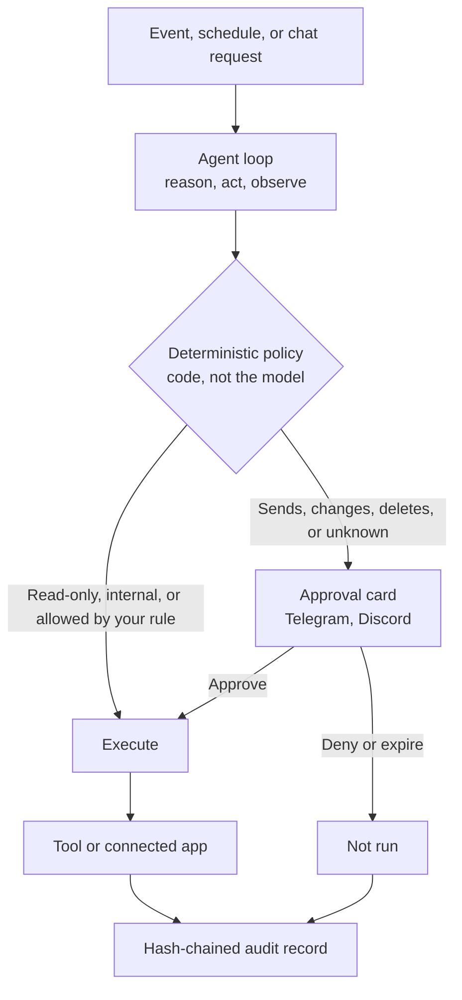
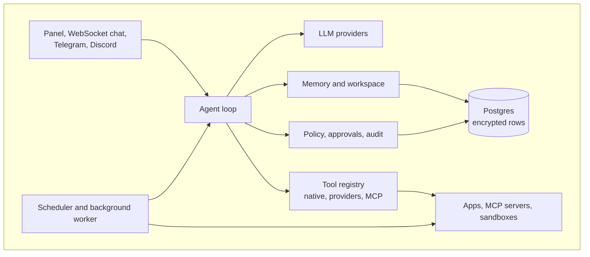

<div align="center" justify-content="center">


# Aether

### A personal agent you can give write access to, because it shows its work.

**The model proposes. Code decides. The record proves it.**

[](LICENSE)
[](https://github.com/Vedant-Git-dev/Aether/actions/workflows/ci.yml)
[](pyproject.toml)
[](#install)

[**Docs**](docs/index.md) · [**Install**](#install) · [**Quickstart**](docs/quickstart.md) · [**Why Aether**](docs/start/why-aether.md) · [**FAQ**](docs/start/faq.md) · [**Contributing**](CONTRIBUTING.md)

</div>

---

Most assistants make you choose: keep the agent read-only and useless, or hand it your
accounts and hope. **Aether is built for the part they skip.**

It is a self-hosted agent that connects to your apps, remembers what is happening across
all of them, and takes actions on your behalf, through native integrations and any MCP
server. But before *anything* runs, deterministic code checks it against a policy **you**
wrote. Reads go ahead. Anything that sends, changes, or deletes waits for **one tap** in
chat. Every decision lands in a hash-chained audit log you can verify with `/verify`.

```text
You       Reply to Sam's email and confirm Friday at 10:00.

Aether    I can send that, but it leaves Aether. Approve it first.
          [ Approve ]   [ Deny ]   [ Read the full text ]

You       Approve

Aether    Sent. The decision record shows the rule that matched and your approval.
```

## Why Aether

- **Policy decides, not the model.** Regular expressions on tool names and call
  parameters, evaluated before execution. There is no LLM in the decision path.
- **One-tap approvals.** Higher-stakes calls park on Telegram or Discord when a chat
  surface is enabled; the web panel monitors the request and the audit trail
- **Tamper-evident audit.** Each record commits to every record before it with SHA-256.
  `/verify` re-walks the chain and reports the first break.
- **Cross-app memory.** Events are deduplicated, people are resolved across handles, and
  recall is semantic when the free embedding model is configured.
- **Bring your own model.** Anthropic, OpenAI, Google Gemini, NVIDIA NIM, Groq, or a
  local Ollama model, with separate slots for images, audio, and video.
- **Yours to host.** One asyncio process and Postgres. No hosted instance, no vendor in
  the middle. Deploy it locally, on your own VPS or any other platform you want

The full trust case, and where the guarantees end, is in
[Why Aether](docs/start/why-aether.md).

## A day with Aether

On Monday you tell a recruiter you will send your availability by Thursday. Thursday is
busy, and the thread goes quiet.

 **Without Aether**:
 
 The promise stays in your head until it is too late. 

 **With Aether**:
 
 The follow-up skill finds the promise in memory (an event with a marker such as "I will" or "follow up"), drafts from its words, and proposes `sending mail`. The policy parks the send, an approval card arrives with the recipient, subject, and body, and you tap **Approve**. 

Before firing, the skill re-checks that the source event still exists. If the thread
moved on, the draft is dropped and you are told why. The audit row records the rule, the
decision, and who approved it.

With the background worker off, the same thing happens when you ask in chat. The gate is
identical.

## How an action flows



1. **Trigger.** A polled event, a scheduled action, an alert, a background task, or a
   message from you.
2. **Reasoning.** The agent loop uses your configured model, recent context, and the
   tools currently connected.
3. **Classification.** [`authz/policy.py`](src/aether/authz/policy.py) evaluates, in
   order: your rules, config-write gates, provider read/write effects, internal tools,
   web research, image generation, risky verbs, read-only verbs, and the fail-safe.
4. **Gate.** Allowed calls execute. Provider writes and anything unknown park. An
   unknown tool can never run silently.
5. **Execution.** The call runs through the connector registry or an MCP server.
6. **Record.** The audit log appends the decision, matched rule, parameter digest, and
   outcome. Parameter values are never stored.

The rules and the built-in ladder are in [Policy](docs/concepts/policy.md).

## Features

### Trust and control

- **Deterministic authorization.** First matching rule wins; no model in the path. See
  [the policy guide](docs/concepts/policy.md).
- **One-tap approvals.** Approve or deny from a connected chat surface, usually
  Telegram or Discord. The web panel shows pending work and the audit trail
- **Tamper-evident audit.** SHA-256 chain over every decision, verified with `/verify`.
- **Contact allowlists.** A cross-app list plus per-app lists for Gmail, Telegram, and
  Discord. Non-allowlisted senders are dropped at ingestion.
- **Security changes park.** Contacts, authz, messaging, and MCP changes always wait for
  approval

### Memory and understanding

- **Deduplicated event memory.** A repeated poll result is stored once.
- **Cross-platform identity.** The same person under different handles is merged into
  one entity.
- **Salience scoring.** A first-pass model, or the main model, decides what is worth
  mentioning. It can be turned off independently.
- **A workspace you confirm.** Markdown identity, tone, preferences, and durable memory.
  Inferred profile entries wait until you say yes.
- **Semantic recall.** Gemini embeddings make memory searchable by meaning.
- **Files become memory.** Images, PDFs, documents, audio, and video frames are described
  or extracted into encrypted events.

### Reach

- **Native app providers.** Gmail, Calendar, Drive, Docs, GitHub, and LinkedIn, with read
  and write tools and polls where they make sense.
- **MCP.** Any stdio or HTTP MCP server, including scheduled poll tools.
- **Chat surfaces.** Telegram and Discord, all carrying approvals. See
  [channels](docs/channels/index.md).
- **Screen vision.** A Wayland companion captures your screen on request; Aether reads
  and remembers it. Perception only, never action.
- **Background work.** Follow-ups, web research, and media jobs inside daily budgets,
  with results that wait for a verdict. See [the workbench](docs/tools/workbench.md).
- **Media.** Generate images, edit video with a fixed operation set, and transcribe voice
  notes.

### Flexibility

- **Model per role.** Route images, audio, video, the first pass, and embeddings
  separately. See [models](docs/models/index.md).
- **Three ways to configure.** `config.yaml`, the Settings panel, or `/config` in chat.
  Chat changes persist and can be reset to the YAML baseline.
- **Self-host anywhere.** One asyncio process and Postgres. A Render blueprint is
  included.
- **Persistent schedules.** Scheduled actions and alerts survive restarts and re-arm on
  boot.

## Install

Aether needs **Python 3.12+** and a **Postgres** database. A free
[Neon](https://neon.tech) database works, and so does a local one. **Node 22+** is only
needed when you build the panel yourself; the deploy engine builds it on Render.

### Linux/macOS:

```bash
git clone https://github.com/Vedant-Git-dev/Aether.git
cd Aether
./scripts/setup.sh
```

### Windows PowerShell:

```powershell
git clone https://github.com/Vedant-Git-dev/Aether.git
cd Aether
.\scripts\setup.bat
```

**Just want to look around first?** Run the real panel against fake in-memory data. No
database, no API key, nothing saved:

```bash
git clone https://github.com/Vedant-Git-dev/Aether.git && cd Aether
python -m venv .venv && source .venv/bin/activate
pip install -e ".[dev]"
cd webapp && npm ci && npm run build && cd ..
python tests/e2e/dev_server.py
```

Open `http://127.0.0.1:8731`, paste the token `secret` under **Settings > Access**, and
inspect the live panel state.

The full question list, `--answers`, `--yes`, `--dry-run`, and the manual install are in
[Getting started](docs/quickstart.md); the wizard and the Render deploy engine are in
[Setup wizard](docs/start/setup-wizard.md).

## Documentation

| Goal | Start here |
| --- | --- |
| Install Aether and send the first message | [Getting started](docs/quickstart.md) |
| Run the wizard or deploy to Render | [Setup wizard](docs/start/setup-wizard.md) |
| Understand the trust case and the limits | [Why Aether](docs/start/why-aether.md) |
| Set a model or a modality slot | [Models](docs/models/index.md) |
| Wire up Telegram, Discord, or the screen companion | [Channels](docs/channels/index.md) |
| Write your own authorization rules | [Policy](docs/concepts/policy.md) |
| Look up a config key or an environment variable | [Configuration](docs/reference/configuration.md) |
| Understand the single process | [Architecture](docs/concepts/architecture.md) |
| See what is encrypted at rest | [Sealed storage](docs/concepts/sealed-storage.md) |
| Run background jobs in your own queue | [Batch queue](docs/tools/batch-queue.md) |
| Fix a boot or channel problem | [Troubleshooting](docs/help/troubleshooting.md) |

## How it fits together

- The **agent loop** is the turn engine. It drains inbound messages, runs polls, calls
  the model, and proposes tool calls.
- The **policy gate** classifies every proposal and parks the risky ones.
- **Approvals** land on Telegram or Discord with the exact call, and the panel shows
  the request and the audit record.
- **Memory** stores deduplicated, encrypted events with entity resolution and semantic
  recall.
- **Connectors** reach your apps, MCP servers, and sandboxes.
- The **scheduler** and **background worker** keep work running across restarts.

A full component and persistence walkthrough is in
[Architecture](docs/concepts/architecture.md).

### Repository map

| Path | Purpose |
| --- | --- |
| `src/aether/agent/` | Agent loop, native tools, prompts, traces, config and app walks |
| `src/aether/api/` | REST endpoints for the panel, companion, and transfers |
| `src/aether/authz/` | Deterministic policy, approvals, hash-chained audit |
| `src/aether/chat/`, `src/aether/connectors/` | WebSocket chat, MCP host, tool registry, Telegram, Discord, attachments, screen vision |
| `src/aether/llm/`, `src/aether/providers/` | LLM adapters, model registry, embeddings, direct app providers, OAuth |
| `src/aether/memory/`, `src/aether/workspace/` | Encrypted events, entities, vectors, salience, Markdown workspace |
| `src/aether/media/` | Media store, image generation, video edits, frames, voice |
| `src/aether/migrations/` | Forward-only SQL migrations |
| `src/aether/proactive/`, `src/aether/skills/` | Background worker, budgets, and the follow-up, research, and media skills |
| `src/aether/alerts/`, `src/aether/scheduler/` | Alerts, reminders, deterministic delivery, persisted scheduled actions |
| `src/aether/workbench/` | Sandbox adapters and the routing ladder |
| `webapp/` | React and Tailwind panel source, built into `src/aether/web/` |
| `tests/`, `companion/`, `docs/` | Unit, integration, and browser tests; Wayland capture CLI; guides |

## Architecture



## Security model and what we do not claim

Aether asks for a lot of access, so it states plainly where the guarantees end.

| Area | What you get |
| --- | --- |
| **Encryption at rest** | AES-256-GCM with a server-held key. Protects stored history against a database-level compromise such as a leaked backup. Does **not** protect against a compromised server process. |
| **Secrets** | The same encrypted store. Provider tokens use a separate keyring so they can be rotated. The audit log stores a parameter digest, never values. |
| **Model providers** | They see prompts, recent context, tool results, and files in a perception call. Choose a provider and retention policy you accept; there is no end-to-end encryption. |
| **Sandboxes** | Receive only the files a job needs, never the database URL, encryption key, or provider tokens. |
| **Web content** | Fetched pages and searches cannot change policy. They reach the profile only as a proposal you confirm. |
| **Screen capture** | Perception only. A screenshot is described, and no action tools are registered for the screen. |
| **Free-tier hosting** | Schedules persist and re-arm on boot, but do not fire while the process is asleep. |
| **Single owner** | `AETHER_TOKEN` is shared by the API, and companion. Aether is not multi-tenant. |

**What we do not claim:** no independent security audit, no end-to-end encryption, no
protection from a compromised host, no guarantee that a model provider excludes your
data from training, and no hosted service-level agreement.

**Report vulnerabilities through [SECURITY.md](SECURITY.md), not a public issue.**

## How it compares

| Attribute | Aether | What to check in an alternative |
| --- | --- | --- |
| Where it runs | Your machine or your cloud account | Vendor-hosted or self-hosted |
| Pre-action policy | Deterministic code, first match wins | Whether policy is a prompt or enforced code |
| Approvals | Telegram, Discord | Where approvals land and whether they expire |
| Audit | SHA-256 chain, verifiable in chat | Whether logs are append-only and checkable |
| Integrations | Native providers plus MCP | Whether your specific apps are covered |
| Models | Anthropic, OpenAI, Gemini, NVIDIA NIM, Groq, Ollama | Whether you can bring a key and route per role |

## FAQ

Short answers live in the docs: [FAQ](docs/start/faq.md). The common ones:

- **Does it run on my laptop?** Yes: Python 3.12+, Postgres, and Node 22 only to build the
  panel.
- **Is there a hosted version?** No.
- **What happens if the server restarts?** Encrypted rows persist, the scheduler
  re-arms, and approvals keep their clock.
- **Can a model act on its own?** It can propose; code decides, and unknowns park.

## Development

A contributor checkout, with no network and no database for the unit suite:

```bash
git clone https://github.com/Vedant-Git-dev/Aether.git
cd Aether
python -m venv .venv
source .venv/bin/activate
pip install -e ".[dev]"

pytest -m "not integration and not e2e"     # unit tests: no network, no database
ruff check src tests
ruff format --check .
```

Integration and browser tests are opt-in and need a throwaway Postgres and Chromium.
See [CONTRIBUTING.md](CONTRIBUTING.md) for the full workflow, the test matrix, and how to
update the docs when you change a field, a command, or a channel.

## Contributing

Pull requests are welcome. Read [CONTRIBUTING.md](CONTRIBUTING.md) first. The unit suite
runs with no network and no database; integration and browser tests are opt-in.

Participation is governed by [CODE_OF_CONDUCT.md](CODE_OF_CONDUCT.md). Report security
issues through [SECURITY.md](SECURITY.md), not a public issue.

## License

[MIT](LICENSE). Built on FastAPI, asyncpg, Pydantic, the official Anthropic, OpenAI,
Google GenAI, and MCP SDKs, python-telegram-bot, py-cord, and a React and Vite panel.

<div align="center">

**If Aether earns your trust, a ⭐ helps others find it.**

</div>
