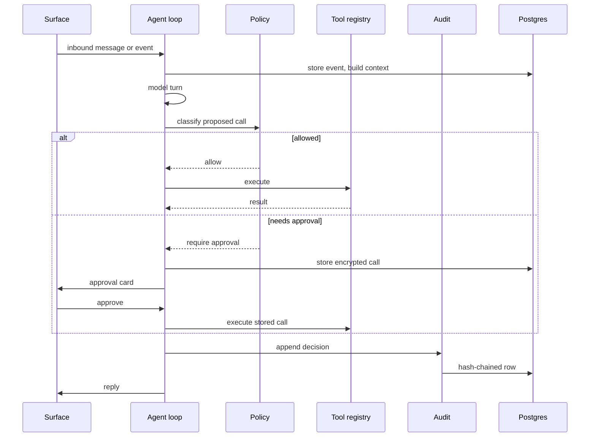

# Architecture

Aether is one asyncio process. The API, the web panel, the agent loop, the scheduler,
the background worker, and the connectors share a single event loop and one Postgres
pool. There is no queue broker, no separate worker service, and no cache tier.

## Boot order

`src/aether/main.py` wires the process in this order:

1. Validate settings. Refuse to boot without a database URL or an encryption key.
2. Build the content cipher and the provider-token keyring.
3. Open the Postgres pool and apply forward-only migrations.
4. Build the secret resolver, then the model catalog.
5. Merge stored config overrides onto `config.yaml`.
6. Compile the policy. A bad regex stops boot.
7. Build counters, web tools, the workbench ladder, and media helpers.
8. Build the audit log, event store, approvals, and agent settings.
9. Start the MCP host and populate the tool registry.
10. Build direct provider connections and register their tools.
11. Build the LLM provider registry and the perception seams.
12. Build the workspace, chat hub, agent loop, and native tools.
13. Build the background worker and its skills.
14. Start messaging connectors.
15. Start the agent loop, the scheduler worker, and the background worker.

A missing optional component logs why and the rest keeps starting. A missing core
component stops boot with the reason.

## Components

### Agent loop

`src/aether/agent/loop.py` is the turn engine. It drains inbound messages, runs polls,
handles commands before ingest, calls the model, and executes proposed tools through the
policy gate. A turn has a hard timeout (`agent.turn_timeout_seconds`). Chat commands are
answered before any model call.

Native tools live in `src/aether/agent/tools.py`: memory search, entity notes,
scheduling, routines, screen-capture requests, media lookup and sharing, image
generation, video edits, config reads and writes, workspace reads and writes, web fetch
and search, traces, and audit verification.

### Authorization

`src/aether/authz/policy.py` classifies each call. `approvals.py` parks calls and
carries out a fresh decision. `audit.py` appends a hash-chained record and verifies the
chain.

### Connectors and providers

`src/aether/connectors/mcp_host.py` runs MCP servers over stdio or HTTP and exposes
their tools. `registry.py` is the single flat namespace the model sees. Native tools,
direct provider tools, and MCP tools all route through it.

`src/aether/providers/` holds the direct app integrations: Google (Gmail, Calendar,
Drive, Docs), GitHub, and LinkedIn. Each declares its tools, their effect (`read`,
`write`, or `destructive`), its OAuth scopes, and its poll. Tokens live in their own
encrypted store under a separate keyring.

### Memory

`src/aether/memory/events.py` stores deduplicated events with encryption and an audit
trail. `entities.py` resolves people across handles. `vectors.py` stores embeddings for
semantic recall. `salience.py` scores what is worth mentioning. `context.py` assembles
the prompt context.

`src/aether/workspace/` is a separate, smaller Markdown layer for identity, tone,
preferences, and curated memory. It is not the event store.

### Media

`src/aether/media/` keeps shared and generated media encrypted in Postgres under a quota
with least-recently-used eviction. It also runs image generation, fixed-operation video
editing, frame extraction, and Groq transcription.

### Background work

`src/aether/proactive/` detects opportunities, claims them, budgets tokens and sandbox
time, runs skills, stores results, and records verdicts. `src/aether/skills/` holds the
three shipped skills: follow-ups, research, and media.

`src/aether/workbench/` routes sandbox jobs across Modal, Vercel, and a GitHub Actions
batch queue. Routing is code; the model is not consulted.

### Scheduling

`src/aether/scheduler/` persists scheduled actions and re-arms them at boot.
`src/aether/routines/` stores event-triggered instructions that fire when a matching
event arrives.

## Data flow

## Persistence

Migrations live in `src/aether/migrations/` and run in filename order. The runner
records each version in `schema_migrations`.

| Table group | Tables |
| --- | --- |
| Memory | `events`, `identities`, `identity_handles`, `entity_notes`, `memory_chunks`, `chat_messages` |
| Trust | `audit_log`, `pending_approvals`, `decision_traces` |
| Automation | `scheduled_actions`, `routines`, `proactive_tasks`, `daily_counters` |
| Configuration | `config_overrides`, `app_secrets` |
| Providers | `provider_connections`, `oauth_tokens`, `provider_oauth_states`, `provider_sync_state` |
| Media and workbench | `media_blobs`, `workbench_transfers`, `workbench_minutes` |
| Delivery | `processed_updates` |

Content columns are AES-256-GCM ciphertext bound to their row and column with additional
authenticated data. Plain columns carry routing metadata: ids, statuses, timestamps,
provider names, and local-day counters.

## Encryption

`src/aether/memory/crypto.py` derives a key from the base64 value in
`AETHER_ENCRYPTION_KEY`. Each encrypted value is bound to its table, column, and row id,
so a ciphertext moved to another row fails to decrypt rather than silently decoding.

Provider OAuth tokens use a separate keyring (`providers/crypto.py`). This lets you
rotate the token key without re-encrypting message history. The rotation tool is
`python -m aether.providers.rotate_tokens`.

## Concurrency and restart behavior

- One process owns the agent loop. Turns are serialized; tool calls within a turn may
  run concurrently.
- The scheduler and background worker are separate asyncio tasks.
- Rows are written at each state transition, so a crash leaves a row that says where the
  work stopped.
- On boot, scheduled actions re-arm, running background tasks return to pending, and
  approvals keep their original expiry.
- A chat-made `llm.*` change arms an in-process restart. The server loop builds a fresh
  app without the container restarting.

## Failure behavior

| Failure | Behavior |
| --- | --- |
| MCP server fails | Logged; the rest boots |
| Provider key missing | That provider's tools are absent; the rest boots |
| LLM key missing | Chat, salience, and vision off; panel and audit work |
| Telegram conflict | Logged; the other surfaces keep working |
| Sandbox dispatch fails | Ladder falls through to the next provider |
| Sandbox job fails | Real failed result; no retry |
| Embedding call fails | Memory search says so plainly |
| Worker keeps failing | Pauses itself and sends one message |

## Where to start reading

- `src/aether/main.py` for wiring.
- `src/aether/agent/loop.py` for the turn.
- `src/aether/authz/policy.py` for the gate.
- `src/aether/connectors/registry.py` for tool dispatch.
- `src/aether/memory/events.py` for storage.
- `tests/` for the expected behavior of each.
