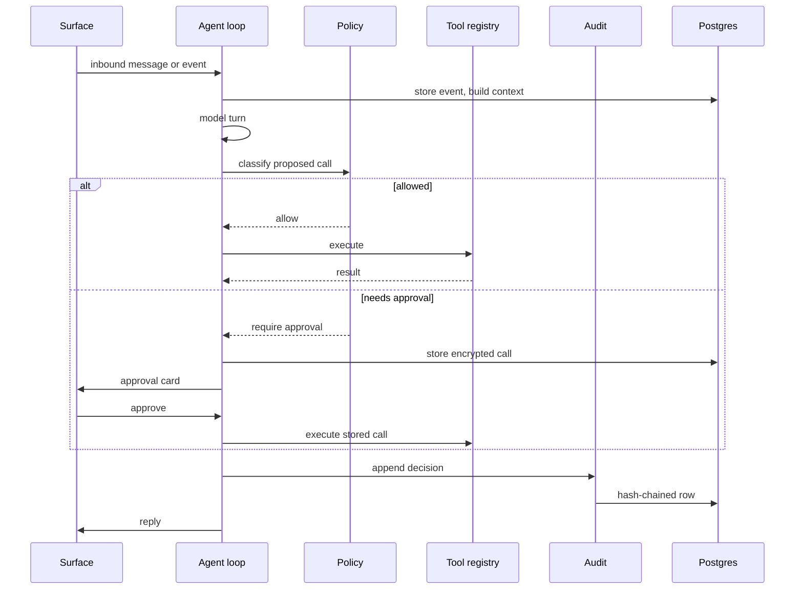

# Architecture

Aether is **one asyncio process**. The API, the web panel, the agent loop, the scheduler,
the background worker, and the connectors share a single event loop and one Postgres
pool. There is no queue broker, no separate worker service, and no cache tier.

**On this page**

- [Boot order](#boot-order)
- [Components](#components)
- [Data flow](#data-flow)
- [Persistence](#persistence)
- [Encryption](#encryption)
- [Concurrency and restart behavior](#concurrency-and-restart-behavior)
- [Failure behavior](#failure-behavior)
- [Where to start reading](#where-to-start-reading)

---

## Boot order

`src/aether/main.py` wires the process in this order:

1. Validate settings. Refuse to boot without a database URL or an encryption key.
2. Build the content cipher and the provider-token keyring.
3. Open the Postgres pool and apply forward-only migrations.
4. Build the secret resolver, then the model catalog.
5. Merge stored config overrides onto `config.yaml`.
6. Compile the policy. A bad regex stops boot.
7. Build counters, web tools, the workbench ladder, and media helpers.
8. Build the audit log, event store, approvals, and agent settings.
9. Start the MCP host and populate the tool registry.
10. Build direct provider connections and register their tools.
11. Build the LLM provider registry and the perception seams.
12. Build the workspace, chat hub, agent loop, and native tools.
13. Build the background worker and its skills.
14. Start messaging connectors.
15. Start the agent loop, the scheduler worker, and the background worker.

> [!NOTE]
> A missing **optional** component logs why and the rest keeps starting. A missing
> **core** component stops boot with the reason.

---

## Components

| Component | Lives in | Responsibility |
| --- | --- | --- |
| [Agent loop](#agent-loop) | `src/aether/agent/` | The turn engine |
| [Authorization](#authorization) | `src/aether/authz/` | Policy, approvals, audit |
| [Connectors and providers](#connectors-and-providers) | `src/aether/connectors/`, `src/aether/providers/` | MCP, tool registry, direct apps |
| [Memory](#memory) | `src/aether/memory/`, `src/aether/workspace/` | Events, entities, retrieval, workspace |
| [Media](#media) | `src/aether/media/` | Media store, generation, transcription |
| [Background work](#background-work) | `src/aether/proactive/`, `src/aether/skills/`, `src/aether/workbench/` | Opportunities, skills, sandboxes |
| [Alerts and scheduling](#alerts-and-scheduling) | `src/aether/alerts/`, `src/aether/scheduler/` | Event alerts, reminders, scheduled actions |

### Agent loop

`src/aether/agent/loop.py` is the turn engine. It drains inbound messages, runs polls,
handles commands before ingest, calls the model, and executes proposed tools through the
policy gate. A turn has a hard timeout (`agent.turn_timeout_seconds`). Chat commands are
answered before any model call.

Native tools live in `src/aether/agent/tools.py`:

- memory search and entity notes
- alerts, reminders and scheduling
- screen-capture requests
- media lookup and sharing
- image generation and video edits
- config reads and writes
- workspace reads and writes
- web fetch and search
- traces and audit verification

### Authorization

| File | Role |
| --- | --- |
| `src/aether/authz/policy.py` | Classifies each call |
| `src/aether/authz/approvals.py` | Parks calls and carries out a fresh decision |
| `src/aether/authz/audit.py` | Appends a hash-chained record and verifies the chain |

### Connectors and providers

`src/aether/connectors/mcp_host.py` runs MCP servers over stdio or HTTP and exposes their
tools. `registry.py` is the single flat namespace the model sees. Native tools, direct
provider tools, and MCP tools all route through it.

`src/aether/providers/` holds the direct app integrations: Google (Gmail, Calendar,
Drive, Docs), GitHub, and LinkedIn. Each declares its tools, their effect (`read`,
`write`, or `destructive`), its OAuth scopes, and its poll. Tokens live in their own
encrypted store under a separate keyring.

### Memory

| File | Role |
| --- | --- |
| `events.py` | Deduplicated events with encryption and an audit trail |
| `entities.py` | Resolves people across handles |
| `vectors.py` | Stores embeddings for semantic recall |
| `salience.py` | Scores what is worth mentioning |
| `context.py` | Assembles the prompt context |
| `views.py` | Structured views read off the resident index |
| `focus.py` | One sealed working set per chat |
| `conclusions.py` | Caches state-of-now answers with `as_of` and `valid_until` |
| `deliveries.py` | Records every outbound send attempt |

All of these live in `src/aether/memory/`.

#### Write-time enrichment

Enrichment runs inside `events.py`:

- **Deterministic floor.** `enrich.py` raises urgency on its own words (ASAP, urgent,
  "within N hours", "by EOD", deadline) before anything is written, so an urgent mail is
  never invisible while a classifier is queued or absent.
- **Model enrichment.** With `memory.enrichment` on, one cheap model turn adds urgency,
  `needs_reply`, action type, deadline phrases, commitments, and a one-line summary. The
  deterministic `normalize_deadline` turns the phrases into absolute instants against
  the event's own time and `memory.default_timezone`.
- **Identity linking.** Every address is linked to an identity through the blind index,
  and an owner address renders "(your other address)".

The enrichment lands in the same sealed `meta_enc`, and the resident index decodes it
once, at load. `views.py` reads the structured views off that index:

- `pending_attention`: urgency descending, deadline ascending, then recency
- open commitments, ordered by due time
- an entity timeline, using the index's `by_entity` map

`focus.py` persists one sealed working set per chat. `conclusions.py` caches
state-of-now answers, and a conclusion past its TTL is never served.

#### Query-time retrieval

Retrieval is one pipeline, controlled by `memory.query_pipeline`. It is **on by
default** since the golden-set evaluation cleared it (see `docs/evaluation.md`);
setting it `false` falls back to the previous vector-only recall.

1. **Route** (`query.py`). Rules route the question first.
   - A resolved reference ("send it", "send then", "the sender", "the assignment") reads
     the focus object and skips search.
   - Attention, commitment, person, document, fact, and open-recall routes carry
     `{time_range, entities, source, doc_ref, urgency_min}`.
   - Short or anaphoric questions are rewritten into at most three keyword queries,
     cached by normalized message and focus hash.
2. **Search lexically** (`lexical.py`). An in-memory BM25 index (k1 1.2, b 0.75) over the
   same sealed chunks, with field boosts (subject and filename x3, sender name x2,
   context header x1), an exact-phrase boost, and typo tolerance over the token
   vocabulary. It never writes. A listener on the one chunk writer keeps it current, and
   a restart rebuilds it from the sealed rows. The resident set is bounded by
   `memory.hot_chunks`; older chunks remain reachable through the vector path, which
   scans the sealed rows.
3. **Fuse and select** (`retrieve.py`). Runs the lists in parallel and fuses them with
   reciprocal rank fusion (k 60) plus the recency, entity, urgency, and salience weights
   from `memory.*`. It selects with MMR (lambda 0.7), keeps at most three chunks per
   event, expands neighbour chunks, and gates on a minimum normalized score plus an
   entity, query-term, or vector match. Nothing clearing the gate returns an explicit
   "no relevant memory" block the model must say out loud.
4. **Verify** (`verify.py`). Checks the finished reply: cited ids must exist in the pack,
   quoted text must appear in the cited chunk, and dates and numbers are checked. One
   regeneration with feedback runs first. Then a deterministic repair marks an
   unsourced quote and adds a single hedge for unchecked details.

The pack cites every chunk as `[E123 | mail | from Name <addr> | date]`, carries the
owner's own addresses, stays inside `memory.pack_token_budget`, and states plainly when
semantic search is unavailable instead of silently narrowing.

`memory_search` is the same pipeline as a model tool, capped at `memory.max_search_rounds`
calls per turn. The golden set in `tests/eval_golden.py` runs offline in CI and gates on
recall@5, MRR, route accuracy, abstain precision and recall, and claim support.

#### Inspection and forgetting

`control.py` owns the owner's read of memory and the only way anything leaves it.

- `MemoryControl.overview/items/claims` feed the panel's **Memory & Context** page:
  resident counts, the newest remembered items (searchable through the same lexical
  index retrieval uses), and the active claims, open promises and newest summaries.
  Every sentence is authored by the backend; no id, event kind or raw timestamp is
  rendered.
- `MemoryControl.forget_event` deletes one event's sealed row and its chunks, drops it
  from the resident and lexical indexes in the same breath, cancels the commitments it
  produced, supersedes the claims it supported, and writes a tombstone in
  `forgotten_events` (keyed blind tokens) so the next poll cannot store the same
  message again. `forget_fact`, `forget_commitment` and `forget_summary` end one claim,
  promise or summary. Every action is audited as `memory.forget`.
- The chat tool `memory_forget` rides the same control. Its provenance gate is the
  alert boundary exactly: only the user's own words (`forget_origin` in the loop) may
  ask for it, so an instruction inside an email can never delete memory.
- A forgotten item is gone from Aether's own store. Provider history, backups and WAL
  may still hold old copies until they expire, and the tombstone is permanent — there
  is no un-forget.

#### The evaluation

`tests/eval_ablation.py` runs the golden set as two arms: lexical plus structured, then
lexical plus structured plus the optional vector signal, split by question shape, with
p50/p95 latency, peak index memory and an unsupported-claim rate. The embedding
decision rule lives in `memory.embedding_min_paraphrase_gain` and is enforced by
`tests/test_eval_ablation.py`: the vector arm must raise paraphrase recall@5 by the
configured margin without breaking `memory.retrieve_latency_p95_ms`. The measured
numbers and the decisions they justify live in `docs/evaluation.md`. The vector path
stays behind `llm.embedding_model`; it is removed only on a clear negative.

#### Deliveries

`deliveries.py` records every outbound send attempt (queued, sent, failed, abandoned).
The body, message id, and error are sealed. A failed send is a code concern, not a model
one: the loop re-delivers the exact words once by code, then abandons the row. The
failure is recorded as an event for the panel, but it is filtered out of the model's
observations, so a delivery hiccup can never trigger a turn or read as a fresh request.

`inbound.py` carries the one-terminal-outcome ledger: each message the user sends is
`received`, then `answered` (with the outbound message id), `failed` or `expired`. A
blank or placeholder model reply makes the inbound `failed` and the user hears one short
notice — it is never left looking unanswered for a later tick to pick up. A message still
`received` past ten minutes is never auto-answered; it gets at most one "still want
this?" check. Only keyed blind tokens and the status word are plaintext; the failure
reason and the outbound id are sealed.

Any string leaving for a person passes one outbound guard first (`outbound.py`): blank,
whitespace-only and bare placeholders (`[empty]`, `<empty>`, `None`, ...) are refused at
the channel layer and never stored, traced or recalled.

#### Workspace

`src/aether/workspace/` is a separate, smaller Markdown layer for identity, tone,
preferences, and curated memory. It is not the event store.

### Media

`src/aether/media/` keeps shared and generated media encrypted in Postgres under a quota
with least-recently-used eviction. It also runs image generation, fixed-operation video
editing, frame extraction, and Groq transcription.

### Background work

`src/aether/proactive/` detects opportunities, claims them, budgets tokens and sandbox
time, runs skills, stores results, and records verdicts. `src/aether/skills/` holds the
three shipped skills: **follow-ups**, **research**, and **media**.

The same package carries commitment reminders. `path.py` reports which
urgency-scaled lead is due, and the agent writes the reminder in its own words.
Event alerts live in `src/aether/alerts/`; see
[Alerts and scheduling](#alerts-and-scheduling).

`src/aether/workbench/` routes sandbox jobs across Modal, Vercel, and a GitHub Actions
batch queue. Routing is code; the model is not consulted.

### Alerts and scheduling

`src/aether/alerts/` is one model with two shapes: an **Alert** matches an inbound
event (a source, a sender, some words, an optional folded action) and a **Reminder**
fires at a time. Matching is pure code over a sealed spec; nothing in the decision is a
model call.

Delivery is deterministic. A match enqueues a sealed candidate in
`alert_notifications`, and code decides whether it is sent now, batched into a digest,
held through quiet hours, suppressed as already told or over the daily cap, or retried
after a surface failure — then the outbox records the outcome. No unprompted model turn
is needed for a notification to land. Wording is its own step: the model may phrase one
sentence from the candidate's structured fields (never the raw payload, never a tool),
and any failure falls back to the message catalog sentence. The decision to speak never
depends on that call.

Provenance is structural: the harness stamps each turn with a `TurnOrigin`
(`src/aether/origin.py`), and only the owner's own message or an approved card may
create, change or remove an alert or forget a memory. The message reference is sealed on
the row. An email can therefore never arm one, however it is worded.

`src/aether/scheduler/` persists scheduled actions and re-arms them at boot. The
`alerts` page and `/api/alerts` expose the same records for pause and removal; the old
`watches` table is a read-only compatibility view until `alerts.compat_until`.

---

## Data flow

---

## Persistence

Migrations live in `src/aether/migrations/` and run in filename order. The runner
records each version in `schema_migrations`.

| Table group | Tables |
| --- | --- |
| Memory | `events`, `identities`, `identity_handles`, `entity_notes`, `memory_chunks`, `chat_messages` |
| Structured memory | `commitments`, `alerts`, `alert_notifications`, `commitment_reminders`, `facts`, `summaries`, `focus`, `conclusions`, `deliveries` |
| Trust | `audit_log`, `pending_approvals`, `decision_traces` |
| Automation | `scheduled_actions`, `routines_legacy`, `proactive_tasks`, `daily_counters` |
| Configuration | `config_overrides`, `app_secrets` |
| Providers | `provider_connections`, `oauth_tokens`, `provider_oauth_states`, `provider_sync_state` |
| Media and workbench | `media_blobs`, `workbench_transfers`, `workbench_minutes` |
| Delivery | `processed_updates`, `inbound_messages` |

Content columns are AES-256-GCM ciphertext bound to their row and column with additional
authenticated data. Plain columns carry routing metadata: ids, statuses, timestamps,
provider names, and local-day counters.

## Encryption

`src/aether/memory/crypto.py` derives a key from the base64 value in
`AETHER_ENCRYPTION_KEY`. Each encrypted value is bound to its table, column, and row id,
so a ciphertext moved to another row fails to decrypt rather than silently decoding.

Provider OAuth tokens use a separate keyring (`providers/crypto.py`). This lets you
rotate the token key without re-encrypting message history. The rotation tool is
`python -m aether.providers.rotate_tokens`.

See the [configuration reference](../reference/configuration.md#content-key-rotation) for the key
variables and rotation steps.

## Concurrency and restart behavior

- One process owns the agent loop. Turns are serialized; tool calls within a turn may
  run concurrently.
- The scheduler and background worker are separate asyncio tasks.
- Rows are written at each state transition, so a crash leaves a row that says where the
  work stopped.
- On boot, scheduled actions re-arm, running background tasks return to pending, and
  approvals keep their original expiry.
- A chat-made `llm.*` change arms an in-process restart. The server loop builds a fresh
  app without the container restarting.

## Failure behavior

| Failure | Behavior |
| --- | --- |
| MCP server fails | Logged; the rest boots |
| Provider key missing | That provider's tools are absent; the rest boots |
| LLM key missing | Chat, salience, and vision off; panel and audit work |
| Telegram conflict | Logged; the other surfaces keep working |
| Sandbox dispatch fails | Ladder falls through to the next provider |
| Sandbox job fails | Real failed result; no retry |
| Embedding call fails | Memory search says so plainly |
| Worker keeps failing | Pauses itself and sends one message |

## Where to start reading

| If you want to understand... | Read |
| --- | --- |
| Wiring | `src/aether/main.py` |
| The turn | `src/aether/agent/loop.py` |
| The gate | `src/aether/authz/policy.py` |
| Tool dispatch | `src/aether/connectors/registry.py` |
| Storage | `src/aether/memory/events.py` |
| Expected behavior of each | `tests/` |
