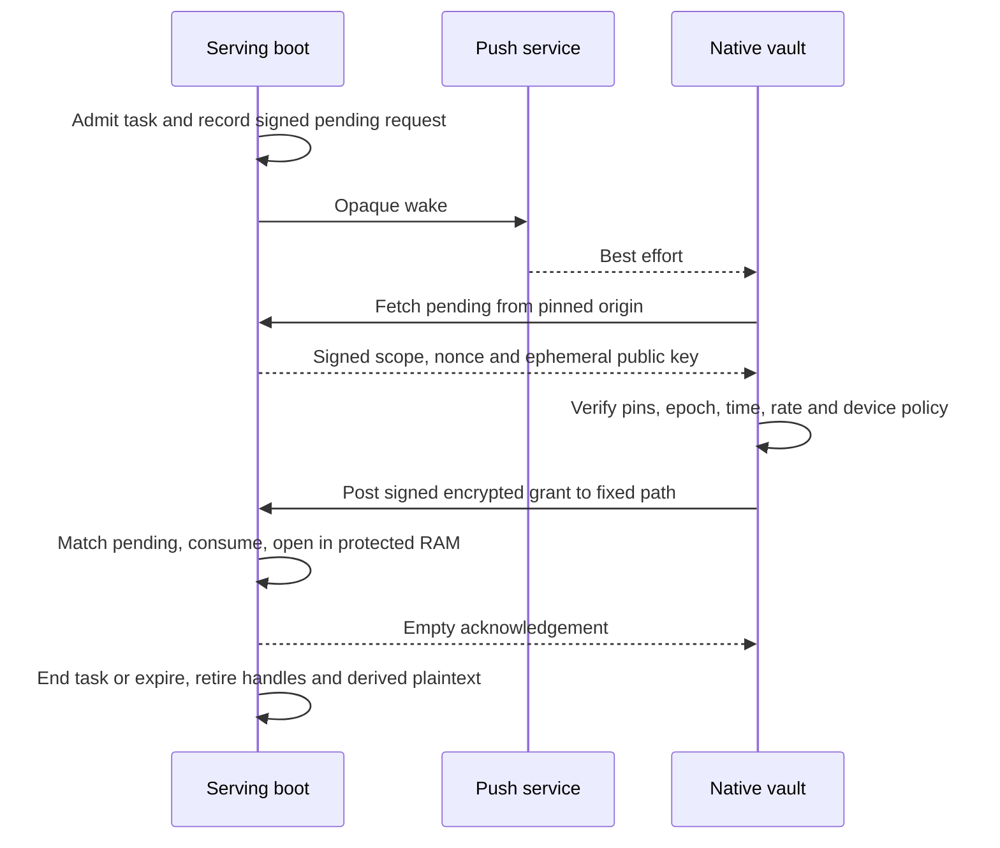
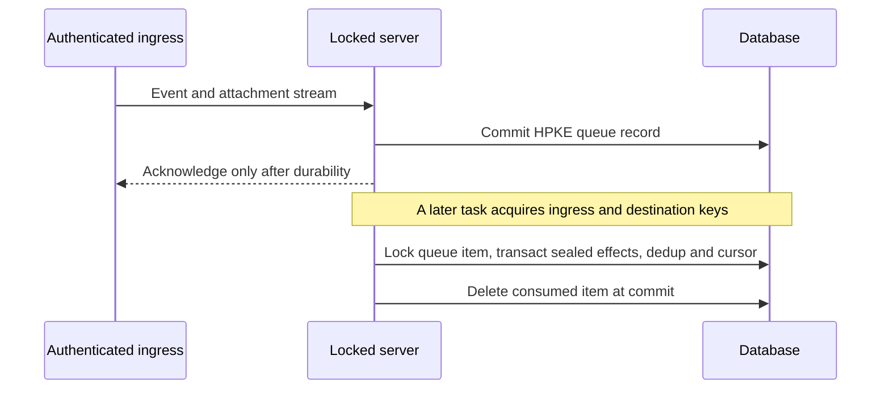

# Aether phone vault protocol v1 — proposed for approval

Implement the owner decisions recorded in [plan.md](plan.md). A change to a field, suite, trust boundary or failure rule requires updated vectors and approval before implementation. One installation has one owner, one active phone and one serving backend generation.

## Keys and storage

| Key or capability | Creator, lifetime and location | Use |
|---|---|---|
| Device master | Native CSPRNG/hardware generation on enrollment. Android non-exportable AES-256-GCM Keystore alias, TEE or StrongBox. iOS fresh Secure Enclave P-256 agreement key, device-only Keychain access policy | Hardware seal/open of individual vault keys. Android uses provider-generated IV. iOS adapter uses platform ECIES cofactor X9.63 SHA-256 AES-GCM envelope with ephemeral sender and authenticated context inside ciphertext. Verify algorithm support on devices before freezing iOS format. Never export, sync, restore or lease this master. |
| Category data key | Native random 32 bytes per vault/category/version | Derive local AEAD, token and dedup subkeys via HKDF-SHA256, separate labels per function and namespace. Each category version has a hardware wrap and a recovery wrap. |
| Ingress key | Native RFC 9180 X25519 key pair per ingress version | Pinned public half available while locked. Private half wrapped like a category key and leased only for backlog drain. No master, recovery key or signer in lease. |
| Recovery authority | Phone generates 256 random bits, encodes entropy and checksum as 24 English BIP39 words via audited library and its packaged word list. Decode and verify checksum to recover original entropy. | HKDF-SHA256 with vault ID bytes as salt, distinct UTF-8 info strings `aether/v1/recovery-hpke` and `aether/v1/recovery-sign`, 32 bytes each. Use first as RFC 9180 KEM DeriveKeyPair input, second as Ed25519 seed. Pin both public keys. Erase entropy and private derivatives after confirmed backup. Public recovery key suffices to back up future versions. |
| Request signer / phone signer | Persistent installation signing key on the serving host / separate hardware signing key on phone | ES256 signatures, P-256 public keys. Server signer authorizes requests only. Device signer authorizes grants, enrollment acceptance and controls. Neither opens stored data. |
| Boot key | Backend native crypto module, fresh X25519 per process boot; discard on loss of leadership or shutdown | HPKE recipient for grants to this boot only. |
| Pair ticket / session token | Independent setup workstation / serving backend respectively, each 32 random bytes | Pair ticket verifier only persisted. Scoped session tokens stored only as hashes server-side. Panel and device sessions are distinct. TLS, bearer headers, origin binding and revocation apply. No reusable panel credential in serving-host configuration. |

The encrypted backup restores access to the **same data keys under a new hardware master**. It requires the phrase and the matching encrypted backup. Restoring the original non-exportable device key would require a different custody requirement. Recovery wraps, device wraps, category registry, signed manifests and ingress public key may live in the database. Bootstrap infrastructure credentials cannot decrypt these records. An old phrase plus an old backup remains able to open that backup.

## Encoding

TLS with normal CA and hostname verification. At pairing pin the exact HTTPS origin (ASCII normalized host and port, no credentials/query/fragment/path); use fixed paths below. Reject redirects, proxy destinations supplied by callers, scheme downgrade, conflicting versions, unknown fields, malformed or repeated JSON keys, non-integer times and noncanonical binary encodings. Restrict native network access to that origin except OS push transport. Push contains only an opaque random wake ID. Fetch the signed pending request at the paired origin; the provider never sees categories, callback URLs or keys.

Wire media type application/json. Identifiers (vault, device, boot, task, request, lease and queue IDs) are independent random 16-byte values. Nonces and pair tickets are random 32-byte values. Binary fields are unpadded base64url. Time is UTC Unix seconds, counters are nonnegative safe JSON integers, initial epoch and manifest revision are 1. Arrays of key references are unique sorted pairs ordered by ASCII category then numeric version. Key reference is an object with exactly `cat,ver`. Wire categories are defined below. SHA-256 hashes operate on raw bytes. P-256 public keys are uncompressed SEC1 points, X25519/Ed25519 keys raw 32 bytes. Validate lengths, public points and primitive errors using the suite library.

Use ES256 detached JWS with fixed protected header `{"alg":"ES256","kid":<signer-id>}`, RFC 8785 canonicalize header and body before signing, standard JWS base64url signing input, raw 64-byte r||s. Transport signed objects as `{body,protected,signature}` with protected already encoded. Signer ID is base64url SHA-256 of the public key bytes in the encoding defined above. The recovery proof uses the same detached format with a protected header whose alg is Ed25519 and whose kid names the pinned Ed25519 key. Lookup trust by paired role and vault. During first pairing and restoration, verify the candidate device key only as proof of possession. A valid pair ticket or the pinned recovery signer separately authorizes the change. Every signed body includes `v:1,type,vault,device,epoch`. Where a digest binds a signed message it hashes the canonical **body** after signature verification. Distinct types prevent cross-endpoint reuse. Use a reviewed JWS library with pinned algorithms. [JWS](https://www.rfc-editor.org/rfc/rfc7515) · [JCS](https://www.rfc-editor.org/rfc/rfc8785) · [Ed25519 JOSE identifier](https://www.rfc-editor.org/rfc/rfc9864.html#section-4.1.1)

Use single-shot RFC 9180 base mode DHKEM(X25519, HKDF-SHA256), HKDF-SHA256, AES-256-GCM (0x0020,0x0001,0x0002). Each seal has fresh encapsulation. Encode output as `{enc,ct}`. Info is UTF-8 `aether/v1/` plus usage (`grant`, `ingress`, `recovery`); AAD is JCS of the usage-specific header. No hand-assembled DH or homegrown key agreement. [HPKE and test vectors](https://www.rfc-editor.org/rfc/rfc9180)

### Persistent envelopes

* Manifest body type `manifest` adds `revision,previous_digest,ingress_public,recovery_public,recovery_verify,entries`. Genesis previous digest is null. Ingress public is an array of version/public-key pairs; entries are sorted key refs augmented with `status` (active/read_only), `wrap` and `backup`. Exactly one active per category. The wrap header is `{v,vault,cat,ver}`. Hardware encrypt JCS of `{header,key}`, validate inner header after open; Android also sets header as GCM AAD. Device wrap format `{alg,blob}`, Android blob = 12-byte IV || ciphertext and tag, iOS opaque platform output. Backup is HPKE(recovery_public, recovery, header, raw key). Phone signs manifest; server stores by compare-and-swap on previous digest. Phone retains highest revision/digest and pinned recovery keys in protected storage. Phone independently checks expected signer, key refs, status and pinned digest; never opens arbitrary server-selected wraps.
* Content envelope is `AE2\0 || JCS({v,vault,cat,ver,n,ct})` as UTF-8 after four magic bytes. Fresh 96-bit nonce `n` per encryption; AES-256-GCM with 128-bit tag. AAD = JCS of `{v,vault,cat,ver,table,column,row,purpose}`; row is a stable opaque record ID as string. Caller supplies trusted expected location and category from registry. Subkey salt = raw vault ID, info = JCS of `{v,cat,ver,fn,namespace}`, length 32; fn = aead/token/dedup. Namespace = registered purpose or token field/domain. Tokens = HMAC-SHA256 over existing normalized UTF-8 or binary input, domain shared only for declared joins. Keep recalculable token inputs sealed; key-versioned uniqueness and rotation rules below. Enforce per-key AES-GCM encryption budget below 2^32 operations across writers/restarts via durable range reservation before use; rotate early, stop on exhaustion. Configure operational threshold below the cryptographic limit.
* Queue envelope header = `{v,vault,queue_id,ingress_ver}`; HPKE(ingress_public, ingress, header, JCS normalized event including sender, source IDs, cursor, event time, text and attachments in base64url). Large streams: encrypt one record per chunk with independent HPKE, header extended with `part` (zero-based) and `kind` (chunk/end); encrypted end record contains ordered chunk hashes, total length and normalized event sans attachment bytes. Accept only complete groups. Reserve queue IDs before sealing, reject substitution/reorder/truncation. No filenames or routing IDs in outer headers.

### Categories and task grants

| Category | Tables / privilege |
|---|---|
| memory | events, identities, identity_handles, entity_notes, chat_messages, memory_chunks, facts, summaries, commitments, commitment_reminders, conclusions, focus, forgotten_events, held_notes |
| workspace | workspace_files including names and keyed name lookup |
| operations | pending_approvals, scheduled_actions, routines_legacy, alerts, alert_notifications, decision_traces, deliveries, proactive_tasks, inbound_messages, processed_updates, connector_cursors, workbench_transfers/minutes, daily_counters, agent_settings, config_overrides, encrypted audit entries |
| media | media_blobs including metadata, tags and dedup |
| credentials | provider_connections, provider_oauth_states, provider_sync_state, oauth_tokens, app_secrets |
| ingress | queue private key only; no general storage API decryption |

Schema bookkeeping, public cryptographic metadata and explicitly reviewed non-content counters have no category lease. Every other field requires classification before shipping. A turn may request memory/workspace/operations only as actually needed; media view adds media only for a concrete item; connector dispatch separately acquires credentials after policy grants the operation; drain uses ingress + destination categories; panel route gets its declared categories after session validation. Credentials never enter the model or panel. Migration/rotation require a separate owner-authorized maintenance session. A lease permits key use solely by the requesting operation. It conveys no permission to send, approve, run tools or traverse categories.

The maximum grant set is the intersection of this table, the code-owned use-case declaration, the phone policy and the requested refs. A versioned registry packaged with both endpoints lists the exact use-case ID and allowed subset. Unknown use cases are denied. The signed request adds `use_case` (registry ID); the server derives it from a typed entry point and the phone resolves it locally.

| Operation | Maximum categories | Additional binding |
|---|---|---|
| turn | memory, workspace, operations | Authorized conversation/task, immutable origin |
| panel_read | memory, workspace, operations, media | Authenticated owner, route and projection; export requires explicit owner gesture |
| approved_dispatch | operations, credentials, media, workspace, memory | Approved call or deterministic policy grant, exact sink and payload version |
| drain | ingress, operations, memory, media | Claimed queue group; workspace/credential mutations run as separate admitted commands |
| index | memory | Index rebuild/read generation only |
| scheduled | operations, memory, workspace | Named due job; all egress through separate dispatch |
| maintenance | any category individually required by journal | Owner locally permits a specific maintenance intent; routine policy cannot grant maintenance |

For private panel mutations use a distinct `panel_write` operation with the same maximum categories as panel_read and a route-specific mutation ID; credential setup is a separate explicit credentials-only `credential_write` under owner consent. Public status is only API availability/pairing-required. Authenticated status is `{state,epoch}` where state is locked/available; detailed task and device log data require the appropriate session. Use GET /status in this namespace. An Android foreground connection uses device-authenticated long polling on GET /pending with a configured wait below the proxy timeout, closed on session expiry, epoch change or disconnect. Only one live wait per paired device; the same verification rules apply to an immediate fetch after push.

## Enrollment, session and control paths

Paths below are relative to `/api/v1/vault`. Use POST for mutations, sensitive bodies, challenge creation and exchange; GET for status, manifest and pending. No query secrets. Access routes send Cache-Control: no-store. Pairing and recovery use native UI.

1. Setup on a trusted operator workstation chooses origin, vault ID, 32-byte ticket, and installs its SHA-256 verifier, expiry and request signing public-key fingerprint through the authenticated deployment setup. Show owner a short-lived QR containing those four fields (ticket in clear locally). Server starts unpaired; no ordinary bearer can mint a first-pair ticket. Reissuing an unused ticket requires operator setup. Never print QR/ticket to shared deploy logs.
2. Phone scans, displays normalized origin, verifies TLS and fetched signer against QR. Create keys, initial manifest and phrase backup, perform phrase confirmation. POST `/pair` with ticket and signed body type `pair` adding `origin,server_kid,phone_pub,manifest_digest,nonce,iat`, plus signed manifest. Verify proof with enclosed phone public key, match ticket and digest, consume ticket and install pins/manifest atomically. Only one concurrent winner. Return device-only bearer over TLS; if reply lost allow reacquisition via signed challenge. Store bearer under device hardware protection. Paired starts locked pending explicit local enable. QR expires in 5 min; first enrollment with lost device and no recovery requires explicit owner intervention.
3. `POST /challenge` takes `{vault,device,purpose}` and returns `{challenge,expires}` with fresh nonce, 60 s lifetime, bound to purpose and installation. `POST /device-session` accepts signed `device_session` adding `challenge,iat`; verify active pinned device, consume challenge, return fresh device-only bearer, lifetime 15 min. Rate-limit challenges before all costly work. Device-authenticated GET `/manifest`, GET `/pending` (204 or one signed request), POST `/grant`, `/deny`, `/control`, `/manifest`, `/push-registration`. Last accepts signed type `push_registration` plus `challenge,provider,registration,iat`; registration is an opaque provider route. For Android, native subscribes to a fresh random 256-bit FCM topic over the FCM SDK; the registration field carries only this random topic, never the phone token. Rotate topic on replacement. For iOS, bind the APNs token directly from the native app to an approved push provider and register only its random per-installation delivery handle. The provider sees the device token; the database holds the opaque route. The serving host may hold a send-only push credential. Both routes carry wake hints only and never enter logs. If a provider requires storing a personal device identifier on the serving host, return D2 for review.
4. Panel login on desktop or bundled UI creates a browser-session secret and sends its SHA-256 challenge to `POST /panel-intent`; returns opaque intent ID + expiry (2 min). Display ID as QR on desktop, pass ID to native pairing UI on phone. Owner verifies origin and displayed matching intent on trusted native screen; device posts signed `panel_consent` with `intent,challenge_hash,iat` to `/panel-consent`. Panel exchanges ID + session secret once via `/panel-token` for memory-only bearer (15 min). Credential never in URL/cookie/JS storage. Verify epoch and scopes each request. Device bearer has no panel read scope. Require PIN/biometric for consent, pairing, policy changes, recovery and reenabling. Routine lease verification uses background-available hardware keys after first device unlock. Panel read rights never authorize exfiltration to another destination.
5. Control body type `control` adds `op,next_epoch,challenge,iat` where op = lock/enable/retire. Local lock immediately persists issuance-disabled and increments epoch, cancels pending work and displays remote acknowledgement separately. Deliver signed lock with base epoch and next=base+1 using challenge for that base; allow lock-only authentication by active device signature after bearer expiry. Retry fresh challenge until acknowledged. Server transaction increments epoch, marks state, invalidates all bearers, requests and grants, then cancels/clears before acknowledgement. Idempotent duplicate for same transition returns current state. Enable needs native owner presence, server acknowledgement and a new epoch. Retire blocks old device permanently. A network partition bounds remote lock by outstanding deadlines; never claim instantaneous remote revocation. Phone serializes controls and reconciles acknowledged epoch before enabling.

## Lease exchange

A lease request body has the common fields and exactly `type=lease_request,boot,task,operation,use_case,request,nonce,iat,accept_until,refs,ttl,epk,manifest_digest`. Operation is a fixed enum (turn, panel_read, approved_dispatch, drain, index, scheduled, maintenance, panel_write, credential_write); no prompt text or caller URLs. Use an allowlisted operation-to-category table enforced on both ends. Phone may reject a set, never expand or silently narrow it. Caller requests concrete active versions, read_only only for drain/read/maintenance against existing records. Persist no pending key payload; authoritative pending map is private to active boot. Push wakes device to pull; sign and serve only current pending entries. Pinning the URL alone is insufficient if a copied signer can inject its own recipient key into that map.

Grant header is common fields plus `type=lease_grant,boot,task,request,nonce,request_digest,lease,iat,exp,refs,manifest_digest`. Phone posts a signed body containing these fields plus `box`. HPKE to request epk with info grant and grant header as AAD, plaintext JCS of `{keys:[{cat,ver,key},...]}` in refs order. Server verifies signature, current phone/epoch/boot/manifest, outstanding exact request digest, category set, deadlines and ownership **before** opening, checks every key length/count and header, then atomically consumes request and installs task-bound handles. Response is 204 with no body. No endpoint returns the posted box. Denial signed as `lease_denied` with `boot,task,request,nonce,request_digest,iat,reason`; reason is fixed enum only (locked, stale, bad_scope, rate, user_required, manifest, unavailable). Unauthenticated garbage gets no signed oracle.

Proposed policy defaults live in one versioned data file consumed by server and native builds. Request accept window 30 s, allowed clock skew 15 s for issuance only. Task completion determines normal key lifetime. The ttl and exp fields bound an individual grant if work stalls or the revocation channel fails. Use the configured 300 s hard ceiling per grant across all categories; remove keys sooner on every terminal path. Phone rejects TTL outside 1..policy maximum or a timestamp outside [now-30,now+15], or accept_until different from iat+30. Grant exp = min(phone_now+ttl,request.iat+ttl). Server rejects grant after accept_until or exp without grace, converts remaining time once to monotonic duration, capped by original monotonic send time + requested TTL. Never extend on wall-clock rollback or retry. Invalidate on suspend/clock discontinuity, boot change, remote epoch change or task end. Phone persists bounded consumed (epoch,request,nonce,digest) ledger through accept window + skew, and rate buckets across reboot (30/minute/device incl renewals, burst 6). Reject duplicate request or nonce under new ID; identical retry may repost identical encrypted grant until accept_until, never issue a later exp. Store retry box only in phone RAM; durable consumed marker committed before posting. Restart/lost box -> new request. Server duplicates for an already accepted exact body return 204 without reinstall; store digest tombstone until window closes.

Acquire ahead only for admitted, named work. Coalesce identical outstanding needs for the same task, schedule renewal at 2/3 of actual lifetime with a fresh request only if the structured task is still executing and the supervisor observed a completed work step since the previous grant. An idle timer or a pending approval cannot renew a grant. A renewal cannot resurrect a finished task. Never maintain a general always-on lease. Keep serving boot under a Postgres advisory session lock with generation fencing on writes and delivery; losing session disables it immediately and cancels handles. During rolling deployment, drain and relinquish before new boot serves. Default health/status available while locked.

Completing a task means its owned children have joined and its last database transaction or outbound delivery decision is settled. On success, failure, cancellation or parking for approval/retry, atomically fence the task against new work, invalidate all pending grants, close every scoped key handle and discard scoped plaintext before reporting completion or parked status. On cancellation, fence first and cancel/join the children. No key bytes are transmitted back to the phone. Resumed work opens a fresh scope. A safety expiry during active work fences the current execution; resume only from an encrypted checkpoint with a fresh grant and reconciled external effects.

While enabled, the native module runs the same pending fetch on push, eligible background reconnect and retry, without a WebView, tap or panel session. After an expired request, the server issues a fresh nonce for still-admitted queued work. OS suppression can delay this exchange. Connectivity never overrides lock-all, enrollment, or first-unlock hardware policy.

### Catch-up when the serving host is unreachable

For a replayable source, resume from its last durably committed cursor and consume pages through the live boundary, inclusive of overlaps. Persist a page checkpoint only after all its events and attachment bytes have durable encrypted receipts. Keep the previous checkpoint on failure. For a source with insufficient retention, operate an independent authenticated receiver while the serving host is down. It encrypts events and attachments with the pinned ingress public key, retains complete groups across restarts, and forwards the original groups over authenticated transport until the serving host confirms durable commit. Group IDs are stable across retries; transactional dedup also uses the original source event identity at drain. Retain old ingress wraps until every registered receiver has drained its old-version backlog. A relay has no ingress private key. A missing page, expired attachment or upstream replay gap requires reconciliation. Never advance the cursor across it or report catch-up complete. Loss before any durable receiver sees an item is recoverable only if the source can replay it.

## State and failures

| Current | Event | Next / observable result |
|---|---|---|
| unpaired | valid ticket and manifest | paired (installed), then locked. Ingress before first key returns retryable unavailable. |
| locked | local enable acknowledged | paired/available, zero keys. Authorized task may request a lease. |
| paired | matching grant | leased for that task and refs only. Other requests can remain locked. |
| leased | task end, expiry, restart, fence loss | release handles, clear corresponding indexes/credentials/results, abort incomplete transaction, re-evaluate queued work. Return to paired if enabled; reads without grant return locked. |
| paired/leased | lock-all | revoked for old epoch, new epoch locked, retain enqueue public key. |
| revoked | late response, prior signer or old phone | reject; only active phone can enable new epoch. Retired phone requires fresh enrollment through recovery. |
| any | corrupt wrap/envelope, signature failure, clock failure | deny, no fallback; issue local catalog status, keep ciphertext for investigation. |

HTTP: 400 malformed/version/duplicate fields; 401 invalid session/signature; 403 denied scope; 409 replay conflict/stale generation/manifest; 410 expired challenge/request; 423 category unavailable or locked; 429 rate limited with Retry-After; 503 transient storage/leadership/unpaired ingest. Return only `{code}` from a closed catalog, no identifiers/key fingerprints from rejected input. Network timeout uses bounded exponential backoff with jitter inside deadlines; fetch pending automatically on the next eligible background wake or reconnect. An optional generic notice reports delay. Never retry an expired grant. Do not wake the phone on unauthenticated reads.

## Rotation, replacement and restore

* For unlock/revoke notices and policy logs keep signed controls, receipt and sequence locally under device protection. The server records only control type, opaque epoch and status. Grant boxes, key bytes, recovery phrases and decrypted content are forbidden in every audit record.
* DEK rotation: owner approves maintenance; phone creates version + both wraps, signs successor manifest, CAS publish; all new writes select active. Read old versions only for declared refs. Shadow reencrypt and retokenize rows and uniqueness domains before switching lookups atomically; quiesce writers for domains affected. Reconcile counts, collisions, read-only references, tombstones and queue backlog. Retire only after verified restore and explicit retention decision. Offline backups require their historical recovery wraps.
* Ingress rotation: keep old private wraps until every old-version queue item drains. Pin new public key from authenticated manifest. Device wrap rotation/replacement: prove possession and unwrap on old device or use phrase flow; rewrap each key under fresh hardware root, change phone signer, epoch and sessions in one transaction. No remote command can replace a key or pinned URL from a lease request.
* Restore: encrypted recovery kit includes vault ID, origin, server signing fingerprint, latest signed manifest, device public key and digest/revision receipt. Export updates after every rotation; owner compares most recent independent receipt. Fetch later manifests only along verified signature/hash succession. If continuity or latest checkpoint cannot be established, stop for owner-led backup reconciliation. Verify backup and keys before retiring the old device. Fresh native app obtains challenge for restore, signs JCS of common fields (old epoch, new device ID, type restore) plus `challenge,previous_digest,new_manifest_digest,new_phone_pub,iat` with recovery Ed25519 (JWS alg Ed25519), and new hardware signer (ES256) over identical body. POST both signatures, new signed manifest and previous digest to /restore. Verify against pinned recovery verification key, enforce CAS and one-use challenge, install new epoch/phone, retire prior pairings and remain locked. Full DB loss also requires encrypted data backup; phrase cannot recreate deleted ciphertext. Disallow OS backup of device secrets or logs.
* Phrase compromise: require verified owner maintenance and replacement recovery authorities, rotate affected DEKs and ingress, reencrypt live data, replace recovery kit. Historical backups remain exposed to the compromised phrase. Lost server signer or changed origin requires independent operator QR and native owner confirmation bound to old pin and new pin, drain/revoke first. No automatic trust-on-first-use repair.

## Interoperability acceptance

Commit public fixed test inputs and expected serialized bytes, signing input/digest, verified ES256 fixture, HPKE enc/ct, AE2 envelope, recovery derivations, both wrap headers and denial/error vectors under tests. Verify RFC vectors first, then cross-decrypt Python↔Kotlin and later Swift; compare verified payloads for randomized signatures and wraps. Negative vectors change each bound field independently, swap categories/rows/epochs, replay across boots, change origin, reorder keys, duplicate JSON properties, introduce trailing bytes or expire by one second. Live keys, sample production payloads and phrase words never appear in published fixtures. [BIP39 entropy and checksum](https://github.com/bitcoin/bips/blob/master/bip-0039.mediawiki)
